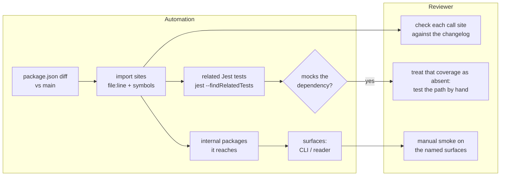

# Dependency update testing policy

How a dependency update gets from a Renovate PR to `main`: what the automated
checks do, what a person does, and how the first informs the second.

The short version: **automation finds where an update can break things and
checks what it can; a person checks what it cannot and makes the call.**
Automation never merges a major. A person never has to work out by hand where an
update lands.

Config: [`renovate.json5`](../renovate.json5). Background: TASK-129 (why
Renovate), TASK-130 (end-to-end tests in CI), TASK-132 (the impact analysis, and
this document).

---

## Who does what

| Role | Who / what | Responsible for | Not responsible for |
| ---- | ---------- | --------------- | ------------------- |
| **Proposer** | Renovate | Opening PRs per the config: grouped minor/patch on Mondays, `[security]` PRs immediately, a weekly lockfile PR. Holding majors and 0.x minors on the Dependency Dashboard. Release notes in each PR body. | Judging whether an update is safe. It only knows version numbers. |
| **Gate** | CI: `build-and-test` and `e2e` in [`ci.yml`](../.github/workflows/ci.yml) | Build, Biome, Jest, and the Playwright CLI smoke + reader browser suites against the PR's own build. | Anything a test mocks, anything no test covers, anything that only shows when a person looks at it. |
| **Analyst** | The dependency impact report (**TASK-132, not built yet**) | For an update that can break: finding every place the repo uses the dependency, which tests really exercise those places, and turning that into a checklist on the PR. | Running anything a person needs to judge. |
| **Reviewer** | A person | Reading the changelog against the call sites the analyst found, manual testing where the gate is blind, and the merge decision. | Re-deriving where a dependency is used, or re-running what CI already ran. |

---

## What each kind of PR needs

Renovate opens four kinds of PR. They differ in what can break, so they differ
in what a person has to do.

### 1. Routine minor/patch (`minor-patch`, `react`, `types`, …)

| Automation | Person |
| ---------- | ------ |
| CI `build-and-test` + `e2e` | Skim the release notes for anything marked breaking despite the version number. Merge when green. |

Minor and patch releases are the ones semver promises are compatible. A green
gate is enough unless the notes say otherwise.

### 2. Weekly lockfile maintenance (`lock file maintenance`)

| Automation | Person |
| ---------- | ------ |
| CI `build-and-test` + `e2e` | Check the e2e job passed (it covers the most here). Skim the lockfile diff for packages **added** or **removed**, not just bumped. Merge weekly. |

This PR is how transitive vulnerabilities get fixed: it regenerates the lockfile
within the declared ranges. It touches hundreds of versions and has no import
sites to analyse, because nothing in the repo imports a transitive dep directly.
So the end-to-end suite carries it. Don't let these pile up: each one rebases on
the last, and a skipped week makes the next one bigger.

### 3. Majors, 0.x minors, and security fixes that cross a major

These are the PRs that can break things. They arrive two ways:

- **`[security]` PRs**, opened immediately. A security fix goes to the newest
  release, which may be a new major (`markdown-it` 8 → 15).
- **Approved from the Dependency Dashboard.** Majors and 0.x minors wait there
  until someone ticks the box, which should be when someone is ready to do the
  migration.

| Automation | Person |
| ---------- | ------ |
| CI `build-and-test` + `e2e`. **The impact report** (TASK-132). **Typecheck diff** against `main`: new errors only (TASK-132). | Work through the impact report's checklist (below). Push any code fixes onto the Renovate branch; Renovate stops rebasing a branch once someone else commits to it. Merge, or convert to a task. |

### 4. Security fixes within range

`[security]` PRs that stay inside the current major (e.g. `lodash` 4.17 → 4.18)
are treated as **kind 1, with priority**: review them the week they open.

---

## How the impact report informs the reviewer

The report is a comment on the PR, updated on each push. It is posted for any PR
that moves a direct dependency across a major, or across a minor below 1.0.0.
Each section of it maps to something the reviewer does:



| Report section | Example (image-size 0.8 → 2) | What the reviewer does with it |
| -------------- | ---------------------------- | ------------------------------ |
| **Import sites**: file, line, the symbols imported and how they are called | `b-ber-grammar-image/src/index.ts:13`, `import sizeOf from 'image-size'`, called `sizeOf(asset)` with a file path; plus 2 more sites | Read the changelog's breaking changes **for those symbols only**. Confirm each call site still matches the new API, or fix it. This is the step that catches most breaks, and it is usually 1–3 files. |
| **Related tests**, flagging any that **mock the dependency** | 24 related; ⚠ 4 mock `image-size` | A test that mocks the dependency passes no matter what the new version does. Treat its coverage as absent. Test that path by hand, or add a test that does not mock it. |
| **Surfaces reached** | CLI (via `b-ber-tasks`) | Tells you which manual smoke checks below apply. CLI is reached by almost every runtime dependency; the reader is the one that varies. |
| **Typecheck diff** | 0 new errors | New errors near an import site mean the API's shape changed. No new errors is weak evidence where the dependency's types come from a separately versioned `@types/*` package. |
| **Gate results** | `e2e` green | Green e2e covers what the kitchen-sink fixture exercises. It does not cover reader navigation while TASK-131's tests are skipped. |

### Until TASK-132 lands

The report doesn't exist yet. Produce its first section by hand:

```bash
git grep -nE "from '<dep>'|require\('<dep>'\)" -- 'packages/*/src'
npx jest --listTests --findRelatedTests <each file found>
git grep -l "jest.mock('<dep>'" -- $(npx jest --listTests --findRelatedTests <file>)
```

---

## Manual testing runbook

For kind 3 PRs. Do only the parts the impact report's surfaces name.

**Set up:**

```bash
gh pr checkout <number>
npm ci --ignore-scripts
npm run build
```

**CLI** (surface: CLI). The suite runs this checkout's CLI build:

```bash
cd packages/b-ber-testing && npx playwright test --project=cli
```

Then build the formats the affected code path feeds, and look at the output.
The fixture exercises every directive.

```bash
cd packages/b-ber-testing/fixtures/kitchen-sink
node ../../../b-ber-cli/dist/index.js build epub     # also: reader, web, pdf, mobi
node ../../../b-ber-cli/dist/index.js check          # validates the project's Markdown
```

| Import site is in… | Check by hand |
| ------------------ | ------------- |
| `b-ber-grammar-*`, `b-ber-parser-*`, `b-ber-markdown-renderer` | The directive's output in a built EPUB or the reader (images, figures, footnotes, …) |
| `b-ber-tasks/src/<task>/` | The build step it names (`cover`, `sass`, `opf`, `web`, `reader`, …) |
| `b-ber-templates` | The generated container, OPF and NCX files, and figure markup |
| `b-ber-lib` | Config and YAML loading: start a fresh project with `bber new`, then build it |

**Reader** (surface: reader):

```bash
cd packages/b-ber-testing && npx playwright test --project=chromium
cd packages/b-ber-reader-react && npm start        # dev reader, by hand
```

While TASK-131 is open, **always navigate by hand**: next/previous chapter, the
table of contents, and a reload to check the position is kept. Those tests are
skipped.

**Decide:**

- **Merge.** Call sites confirmed, gate green, manual checks done.
- **Fix on the branch.** Small migration work; commit it to the Renovate branch.
- **Convert to a task.** The migration is real work (e.g. `markdown-it` 8 → 15
  across the renderer). Open a task, link the PR, and leave the PR open. For a
  `[security]` PR, record the advisory and its severity in the task so the risk
  of waiting is visible.

---

## What exists today

| Piece | State |
| ----- | ----- |
| Renovate PRs, dashboard, security labels | Live (TASK-129) |
| CI `build-and-test` (required) | Live |
| CI `e2e`: Playwright against the PR's own build | TASK-130. Not yet a required check |
| Reader navigation e2e coverage | **Missing.** 6 tests skipped (TASK-131) |
| Impact report on the PR | **Not built** (TASK-132) |
| Typecheck diff vs `main` | **Not built** (TASK-132). Plain typecheck fails on `main` (TASK-119) |
